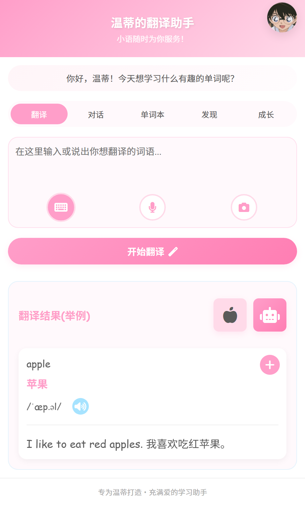
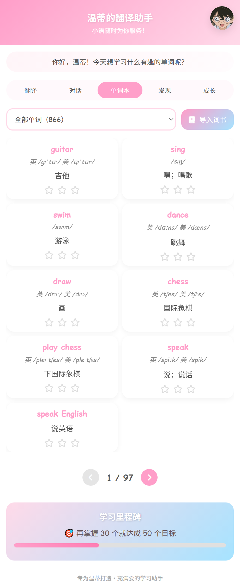
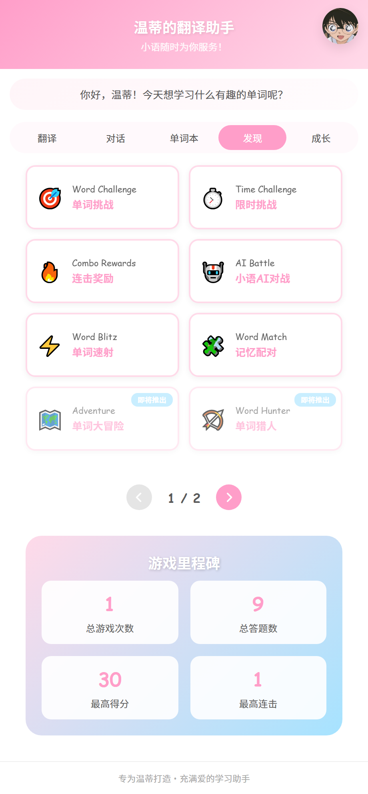
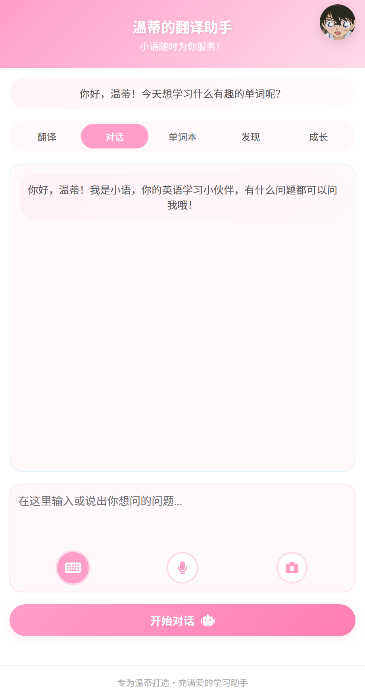
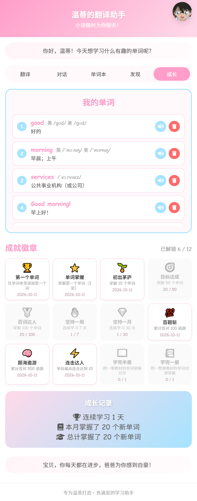

<div align="center">
  

  <h1>温蒂的翻译助手</h1>

  <p>一个专为女儿温蒂设计的个性化翻译学习应用<br />
  采用前后端分离架构，提供友好的用户体验和强大的学习功能</p>

  <p>
    <a href="LICENSE"></a>
    
    
    <a href="docker-deploy.md"></a>
  </p>
</div>

## 🌟 功能特性

### 核心功能
- 🔄 **智能翻译** - 英中文本互译，支持多种输入方式
  - 🏆 **金山词霸优先** - 单个英文单词优先使用金山词霸，提供详细词典信息
  - 📖 **完整词典信息** - 词性、美式音标、发音音频、例句及例句翻译
  - 🔄 **智能备用** - 金山词霸无结果时自动切换到有道翻译
  - 🔊 **音频播放** - 支持单词发音和例句发音播放
- 🤖 **AI对话助手（小语）** - 集成DeepSeek AI，温蒂的英语学习小伙伴和智能翻译助手
- 📚 **单词本管理** - 保存、复习、掌握程度跟踪、删除
  - ⭐ **掌握程度** - 0-3 星标记，三星自动移入「我的单词」
  - 🗑️ **删除单词** - 卡片悬停显示删除按钮，带应用内确认弹窗
- 📊 **学习进度** - 详细的学习统计和里程碑
  - 📅 **连续学习天数** - 从今天往前统计连续学习天数
  - 📈 **本月掌握** - 统计当月达到3星掌握的单词数
  - 📊 **总计掌握** - 统计所有达到3星掌握的单词总数
- 🏆 **成就徽章墙** - 12 个成就，拿到的彩色、没拿到的灰显并显示还差多少
- 🎯 **学习里程碑** - 单词本页列表和分页下方，显示「再掌握 N 个就达成 M 个目标」，
  目标是 50 → 100 → 200 → 300 → 500 … 自动升档
- 🎨 **个性化界面** - 多主题、头像、语言切换
- 🎤 **语音设置** - 支持中英文语音切换，简短昵称显示（小柔、小星、小莹等），
  对单词本、翻译结果、AI 对话三处朗读均生效
- 💬 **鼓励消息** - 随机显示鼓励话语，激励学习
- 🎮 **单词游戏系统** - 发现页提供多种单词学习游戏
  - 🎯 **单词挑战** - 根据中文意思选择对应英文单词，支持连击奖励
  - ⏱️ **限时挑战** - 在限定时间内尽可能答对更多题目，答对可获得时间奖励
  - 🔥 **连击奖励** - 连击数越高得分倍数越高，支持连击保护机制
  - 🤖 **小语AI对战** - 与AI（小语）进行答题对战，比拼得分和正确率
  - ⚡ **单词速射** - 单词快速下落，需要快速点击正确答案，支持多种模式
  - 🧩 **记忆配对** - 翻牌配对游戏，找到单词和中文意思的配对
  - 🏹 **单词猎人** - 听发音 / 看中文，从飘动的目标里打中正确的单词；
    连对 5 个进入「狂暴时刻」双倍分，打错会把正确答案高亮并读一遍
  - 🧠 **词汇拼图** - 把打散的字母拼成单词，三级难度自动递进（字母池拼写 → 首字母提示 → 听写挑战）；
    拼错有引导式纠错（先标出对错位置，再提示某个字母，最后一起拼完，绝不卡住）
  - 🗺️ **单词大冒险** - 森林岛 5 关闯关，每关 5 道混合题（选择 / 听音 / 拼写），
    通关拿星星、掉贴纸、解锁下一关，最后一关是守关怪 Boss 战
  - 🧠 **游戏联动背记** - 三款新游戏共用一套底座：自适应出题（掌握程度低、常错的词优先出现）、
    错词回炉（本局错的词必再考一次）、**连续答对 3 次自动给单词本升 1 星**（上限 3 星），
    星星 / 贴纸 / 关卡进度存在服务端，手机和电脑共用同一份
  - 🔊 **游戏音效** - 所有游戏支持音效反馈，提升游戏体验
  - 📊 **游戏里程碑** - 每个游戏独立的统计数据（游戏次数、答题数、最高得分、最高连击）
  - 🎨 **游戏卡片** - 9款游戏卡片展示，支持分页浏览
  - 📁 **模块化架构** - 每个游戏独立的目录结构（HTML+CSS+JS），便于扩展和维护
- 🖼️ **图片搜索** - 集成Pixabay API，为单词提供记忆图片
- 🎤 **语音输入** - 集成百度语音API，按住说话转文字；
  识别语言跟随界面语言（中文界面识别中文、英文界面识别英文）
- 📷 **图像识别** - 集成百度OCR API，支持拍照识别文字

### 技术特性
- 💾 **SQLite数据库** - 轻量级本地数据存储
- 🌐 **RESTful API** - 标准化后端接口
- 🤖 **DeepSeek集成** - 强大的AI对话和学习辅助
- 🎯 **响应式设计** - 适配各种设备
- 🔊 **语音朗读** - 发音练习功能
  - 🎵 **Web Speech API** - 浏览器原生语音合成
  - 🎤 **语音选择** - 支持选择中英文语音，显示简短昵称
  - 🔊 **音频播放** - 支持MP3音频播放（金山词霸、有道翻译）
- ⚡ **实时缓存** - 提升翻译性能
- 🎵 **游戏音效系统** - 基于Web Audio API的音效生成，支持音量控制和动态音调调整
- 🔧 **模块化架构** - 清晰的前后端分离设计
- 📝 **实时日志** - 翻译服务日志实时输出，便于调试

## 🏗️ 项目架构

```
wendy-translator/
├── 📱 frontend/               # 前端文件
│   ├── index.html           # 主页面
│   ├── api.js               # API客户端和核心逻辑
│   │                         # - 翻译结果显示
│   │                         # - 语音设置管理
│   │                         # - 学习进度统计
│   │                         # - AI对话处理
│   ├── style.css            # 样式表
│   └── img/                 # 图片资源
│       ├── kenan.jpg        # 柯南头像
│       ├── xiaowanzi.jpg    # 小丸子头像
│       └── duola.jpg        # 哆啦A梦头像
├── 🖥️ backend/               # 后端文件
│   ├── core/                # 核心应用
│   │   ├── app.py          # Flask主服务器
│   │   │                   # - RESTful API路由
│   │   │                   # - 学习进度统计
│   │   │                   # - 用户资料管理
│   │   │                   # - 鼓励消息API
│   │   └── config.py       # 配置管理
│   ├── database/            # 数据库相关
│   │   ├── database_init.py # 数据库初始化
│   │   │                   # - 创建数据表
│   │   │                   # - 添加新字段（audio_url, voice_name等）
│   │   └── wendy_translator.db # SQLite数据库
│   ├── services/            # 服务层
│   │   ├── translation_service.py # 翻译服务
│   │   │                       # - 金山词霸集成
│   │   │                       # - 有道翻译备用
│   │   │                       # - 音频URL提取
│   │   │                       # - 例句提取
│   │   ├── deepseek_service.py # DeepSeek AI服务
│   │   │                       # - AI角色定义（小语）
│   │   ├── image_service.py # 图片搜索服务
│   │   │                       # - Pixabay API集成
│   │   │                       # - 关键词清理
│   │   ├── speech_service.py # 语音识别服务
│   │   │                       # - 百度语音API集成
│   │   │                       # - 音频格式转换
│   │   ├── ocr_service.py   # 图像识别服务
│   │   │                       # - 百度OCR API集成
│   │   ├── configure_api.py # 百度API配置工具
│   │   ├── configure_youdao_api.py # 有道API配置工具
│   │   ├── configure_baidu_speech_api.py # 百度语音API配置
│   │   ├── configure_baidu_ocr_api.py # 百度OCR API配置
│   │   └── deepseek_config.json # DeepSeek配置文件
│   └── utils/               # 工具函数
│       └── setup_translation_api.py # API设置工具
├── ⚙️ config/                # 配置与启动
│   ├── requirements.txt     # Python依赖
│   └── start_app.py         # 启动脚本
│                             # - 依赖检查
│                             # - 数据库初始化
│                             # - API配置
│                             # - 实时日志输出
├── 🔐 .env.example           # 环境变量模板（复制为 .env 后填密钥，可提交）
├── 🔐 .env                   # 本地密钥文件（已被 .gitignore 忽略，切勿提交）
├── 🚀 start.bat              # 项目根目录启动脚本 (Windows)
├── 🚀 start.sh               # 项目根目录启动脚本 (Linux/Mac)
└── 📖 README.md               # 项目文档
```

## 🚀 快速开始

### 系统要求
- Python 3.8+
- 现代浏览器 (Chrome, Firefox, Safari, Edge)

### 第 1 步：配置密钥（.env）

所有 API 密钥统一放在项目根目录的 `.env` 文件中，**不要写进代码，也不要提交到 Git**。

```bash
# Windows
copy .env.example .env

# Linux / Mac
cp .env.example .env
```

然后编辑 `.env`，把占位值替换成你自己的真实密钥：

| 变量 | 用途 | 获取地址 |
|------|------|----------|
| `TRANSLATION_SERVICE` | 翻译优先级：`youdao` 或 `baidu` | — |
| `BAIDU_APPID` / `BAIDU_SECRET` | 百度翻译 | [百度翻译开放平台](https://fanyi-api.baidu.com/manage/developer) |
| `YOUDAO_APPKEY` / `YOUDAO_SECRET` | 有道翻译 | [有道智云控制台](https://ai.youdao.com/console/) |
| `DEEPSEEK_API_KEY` | AI 对话助手「小语」 | [DeepSeek 开放平台](https://platform.deepseek.com/api_keys) |
| `BAIDU_SPEECH_APP_ID` / `BAIDU_SPEECH_API_KEY` / `BAIDU_SPEECH_SECRET_KEY` | 百度语音识别 | [百度智能云控制台](https://console.bce.baidu.com/ai/) |
| `BAIDU_OCR_API_KEY` / `BAIDU_OCR_SECRET_KEY` | 百度 OCR 文字识别 | 同上，可与语音识别共用 |
| `PIXABAY_API_KEY` | 单词配图 / 记忆图片（点击苹果图标触发） | [Pixabay API](https://pixabay.com/api/docs/) |

> 💡 **只填你需要的即可。** 某项留空时对应功能会自动降级：翻译回落到模拟翻译、AI 对话不可用，不影响其他功能的正常使用。
>
> 💡 `.env` 已被 `.gitignore` 忽略，不会进入版本库；`.env.example` 是不含密钥的模板，可以放心提交。

### 第 2 步：启动服务

**方法一：一键启动（推荐）**

Windows:
```bash
start.bat
```

Linux/Mac:
```bash
chmod +x start.sh
./start.sh
```

脚本会自动完成：检查 Python 版本 → 安装依赖 → 初始化数据库 → 加载 `.env` → 启动后端 → 打开浏览器。

**方法二：手动启动**

```bash
# 1. 安装依赖（建议使用虚拟环境）
python -m venv .venv
.venv\Scripts\activate            # Windows
# source .venv/bin/activate       # Linux / Mac
pip install -r Config/requirements.txt

# 2. 初始化数据库
python Backend/scripts/database_init.py

# 3. 启动服务
python Backend/core/app.py
```

### 第 3 步：访问应用

浏览器打开 http://localhost:5000

## 🐳 Docker 部署（可选）

除本地运行外，项目也支持容器化部署。

```bash
# 1. 配置密钥（Docker Compose 会自动读取根目录的 .env）
cp .env.example .env        # Windows: copy .env.example .env

# 2. 构建并启动
docker compose up -d --build

# 3. 查看状态与日志
docker compose ps
docker compose logs -f

# 4. 停止
docker compose down
```

- 访问地址同样是 http://localhost:5000
- 数据库持久化在 `./database/` 目录，删除容器不会丢数据
- 容器内以 `FLASK_DEBUG=false` 运行（调试模式默认关闭，避免 Werkzeug 调试器暴露）
- 容器内目录为小写（`/app/backend`、`/app/frontend`、`/app/config`），
  应用通过不区分大小写的方式解析路径，因此仓库中的大小写写法在容器里同样可用
- 构建时 pip 默认使用阿里云镜像源；海外网络可覆盖：
  `docker compose build --build-arg PIP_INDEX_URL=https://pypi.org/simple/`

更详细的说明见 [docker-deploy.md](docker-deploy.md)。

## 📱 使用指南

> 以下截图均为项目**实际运行界面**，点击图片可查看原图。

<p align="center">
  
  
  
</p>
<p align="center">
  <sub><b>翻译</b> · 单词翻译与词典信息　　<b>单词本</b> · 单词管理与掌握度　　<b>发现</b> · 单词学习游戏</sub>
</p>

<p align="center">
  
  
</p>
<p align="center">
  <sub><b>对话</b> · AI 助手「小语」　　<b>成长</b> · 学习统计与成就</sub>
</p>

### 基础翻译


1. 在输入框输入英文单词或句子
2. 点击"开始翻译"按钮
3. 查看翻译结果，包含：
   - **原单词** - 输入的英文单词
   - **词性** - 单词的词性（名词、动词等）
   - **词意** - 中文翻译
   - **美式音标** - 美式英语音标标注
   - **发音按钮** - 点击小喇叭图标播放单词发音
   - **例句** - 英文例句及中文翻译
   - **例句发音** - 点击例句旁的小喇叭播放例句音频
4. **翻译策略**：
   - 单个英文单词：优先使用金山词霸，提供完整词典信息
   - 句子或短语：使用有道翻译API
   - 自动备用：金山词霸无结果时自动切换到有道翻译

<br clear="right" />

### 单词本管理


1. 翻译后点击"添加到单词本"
2. 在"单词本"标签页查看所有单词
3. 点击星星设置掌握程度（0-3星）
4. 三星单词会显示祝贺动画，并移入"我的单词"
   - 学成的瞬间目标进度条和成就徽章会自动更新
5. **删除单词**：鼠标悬停单词卡片，点击**左上角的垃圾桶图标**，
   在确认弹窗中点击"删除"即可移除
   （触屏设备没有悬停，图标会常显）
6. **导入教材词书**：点右上角「导入词书」，整册导入人教版教材单词（见下方说明）
7. **按册筛选**：单词本顶部的下拉框可以只看某一册的单词。
   下拉里的数字是**还在学的词数**（3 星的词已经移入成长页「我的单词」，
   不计入这个数字，也不在单词本列表里显示）
8. **点卡片看详情**：点单词卡片（星星 / 喇叭 / 垃圾桶以外的区域）打开详情弹窗 ——
   词性、音标、最多 3 条例句（含中文翻译）、来源册次、星级与复习次数。
   内容**全部来自本地数据，断网也能看**；单词朗读优先用教材数据里的真人发音，
   取不到才回退到语音合成
   - **更多信息（异步补全）**：弹窗底部还有一块，联网补上
     词态变化 / 同义词 / 反义词 / 记忆图片
     - 数据库里已经补过的词 → 直接显示
     - 没补过的 → 显示一个「补充详细信息」按钮，点了才调 AI
       （886 个词全自动补一遍要调 886 次 AI、每次好几秒，没必要）
     - 生成结果存进 `word_details` 表，同一个词只会调一次 AI
     - **断网或生成失败都不影响上面的内容**，只是这块显示不出来
9. **学习里程碑**：单词列表和分页**下方**有一块渐变卡片，显示
   「🎯 再掌握 N 个就达成 M 个目标」和进度条。
   它只讲差距和进度，累计数字在成长页 —— 两处不重复

#### 导入教材词书

单词本顶部有一个「导入词书」按钮，可以把**整册教材**的单词一次性加进来 ——
每个词都自带**音标、例句和例句翻译**，导入后不用再逐个查词补全。

词表**不在仓库里**，需要你在电脑上生成一次（详见 `data/wordlists/README.md`）：

```bash
python tools/build_wordlists.py
```

脚本会从公开的第三方词库拉取人教版教材词汇并转成 CSV，放在 `data/wordlists/`
（该目录已被 `.gitignore` 忽略，不会进版本库）。目前覆盖：

| 册次 | 词数 | 册次 | 词数 |
|---|---:|---|---:|
| 人教版 五年级上册 | 131 | 人教版 五年级下册 | 156 |
| 人教版 六年级上册 | 130 | 人教版 六年级下册 | 108 |
| 人教版 初一上册 | 392 | 人教版 初一下册 | 492 |
| 人教版 初二上册 | 419 | 人教版 初二下册 | 463 |
| 人教版 初三上册 | 551 | | |

**导入是幂等的**：已经在单词本里的词会自动跳过，重复点击不会产生重复词。
不同册之间有重复单词时（比如 `hello`、`good`），会保留**第一次导入时**那册的来源标记。

> ⚠️ 这些词表来自第三方整理、**没有开源许可证**，所以只在本机使用、不进入版本库。
> 原因和风险说明见 `data/wordlists/README.md`。

<br clear="right" />

### 个性化设置
1. 点击右上角头像打开设置
2. **更换头像**: 选择喜欢的角色头像（柯南、小丸子、哆啦A梦）
3. **更换主题**: 粉色、蓝色、紫色、绿色四种主题
4. **语言设置**: 中文/英文界面切换
   - 切换语言时，所有界面文本（包括语音设置）都会同步更新
   - 语音**识别**语言也会跟随界面语言：中文界面识别中文，英文界面识别英文
5. **音效设置**: 调节朗读音量
6. **语音设置**: 选择AI语音朗读的声音
   - 支持中英文语音分类显示
   - 语音选项显示为简短昵称（如：小柔、小星、小莹等）
   - 鼠标悬停显示完整语音名称
   - 支持中英文界面切换
   - 该设置对单词本、翻译结果、对话三处的朗读均生效
     （若翻译结果带有真人发音 MP3，则优先播放 MP3）

### AI对话助手 (小语)


1. 切换到"对话"标签页
2. 输入英语学习问题或想要探讨的内容
3. **小语**（温蒂的英语学习小伙伴和智能翻译助手）提供详细解答和个性化辅导
4. 支持连续对话和上下文理解
5. 提供英语学习建议和语法解释
6. 支持语音朗读AI回复（点击消息旁的小喇叭图标）

<br clear="right" />

#### 使用示例
- "请解释apple这个单词的用法"
- "帮我分析这个英语句子的语法"
- "我想学习关于水果的英语单词"

#### 小语的特点
- 名字：小语（不是温蒂，温蒂是用户）
- 角色：温蒂的英语学习小伙伴和智能翻译助手
- 风格：像好朋友一样陪伴学习，提供鼓励和支持

### 学习跟踪


1. 查看"成长记录"了解学习统计
2. **连续学习天数** - 从今天往前统计连续学习的天数
3. **本月掌握** - 统计当月达到3星掌握的单词数量
4. **总计掌握** - 统计所有达到3星掌握的单词总数
5. **我的单词** - 查看所有已掌握的单词（3星单词），**一行一个**，
   前面带序号（1、2、3…），行尾有朗读和删除按钮
   - 点朗读按钮播放单词发音

> 成长页从上到下依次是：**我的单词 → 成就徽章 → 成长记录**。
> 「我的单词」词多时内部滚动，不会把下面的内容挤下去。

### 成就徽章

成长页中间是**徽章墙**（4 列网格），共 12 个成就：

| 徽章 | 条件 |
|---|---|
| 🏆 第一个单词 | 往单词本里添加第一个词 |
| ⭐ 单词掌握 | 掌握第一个单词（3 星） |
| 🌱 初出茅庐 | 掌握 10 个单词 |
| 🎯 目标达成 | 掌握 50 个单词 |
| 🏅 百词达人 | 掌握 100 个单词 |
| 🔥 坚持一周 | 连续学习 7 天 |
| 💎 坚持一月 | 连续学习 30 天 |
| 💯 百题斩 | 累计答对 100 道题 |
| 🧠 题海遨游 | 累计答对 500 道题 |
| ⚡ 连击达人 | 单局最高连击达到 10 |
| 📖 学完半册 | 把一册教材的单词掌握过半 |
| 📚 学完一册 | 把一整册教材的单词全部掌握 |

**拿到的**显示彩色图标和获得日期；**没拿到的**整体灰显，并显示进度
（比如「18 / 50」）—— 这样孩子知道下一个徽章还差多少。

成就是**自动判定**的：不需要在每处业务代码里埋点。打开应用或进入成长页时，
后端会按当前数据算一遍，把新达成的写进 `achievements` 表。
所以点星星、玩游戏、导入教材都会自动跟上。
7. **鼓励消息** - 页面顶部随机显示鼓励话语，激励学习

<br clear="right" />

### 单词学习游戏

发现页共有 9 款游戏。前 6 款是看词选义、限时抢答、连击、小语 AI 对战、下落速射、翻牌配对，新增的 3 款是：

- 🏹 **单词猎人**：三分之二的题目只**播放发音**（听音模式），要从飘动的目标里打中听到的那个词；
  其余给中文意思找英文。连对 5 个进入 8 秒「狂暴时刻」——金色目标、双倍分、速度更快。
  打错不扣命：正确目标会高亮并读一遍，可以自己补答。
- 🧠 **词汇拼图**：给中文意思，把打散的字母拼成单词。难度自动递进——
  第 1 关字母池里有多余干扰字母，第 2 关首字母已替她放好，第 3 关只听发音自己拼
  （长单词会自动留在简单档，避免挫败）。拼错先标出哪几个位置对了，再错提示一个字母，
  第三次一起拼完，**绝不会卡在一个词上**。每拼对一个词收下一块「单词碎片」，存服务端跨设备同步。
- 🗺️ **单词大冒险**：森林岛 5 关，每关 5 道混合题（选择 / 听音 / 拼写）。
  5 题全对 3 星、对 3~4 题 2 星、其他 1 星（完成就有星，不给 0 星），每关掉一张贴纸；
  最后一关是守关怪 Boss（5 点血，一次答对扣 2 点）。星星只升不降，可以反复刷星。

三款新游戏共用一套背记机制：优先抽「掌握程度低 / 经常答错 / 上次答错」的词，
本局答错的词**一定会再考一次**，同一个词**连续答对 3 次会自动升 1 星**
（也就是：玩游戏真的会推进单词本进度，不再只是刷分数）。

## 🔧 API 接口

### 翻译服务
- `POST /api/translate` - 文本翻译
  - **翻译策略**：
    - 单个英文单词：优先使用金山词霸API，提供完整词典信息
    - 句子或短语：使用有道翻译API
    - 自动备用：金山词霸无结果时自动切换到有道翻译
  - **返回字段**：
    - `original_text` - 原文本
    - `translated_text` - 翻译结果
    - `part_of_speech` - 词性
    - `pronunciation` - 美式音标
    - `audio_url` - 单词发音音频URL
    - `example_sentence` - 英文例句
    - `example_translation` - 例句翻译
    - `example_audio_url` - 例句发音音频URL
    - `source` - 翻译来源（iciba/youdao/baidu等）
- `POST /api/translate/baidu` - 百度翻译专用接口
- `POST /api/translate/youdao` - 有道翻译专用接口

### AI对话服务 (DeepSeek)
- `POST /api/chat` - AI对话问答
- `GET /api/chat/history` - 获取对话历史

### 用户管理
- `GET /api/user/profile` - 获取用户资料
- `POST /api/user/profile` - 更新用户资料
- `POST /api/user/avatar` - 更新用户头像

### 单词本
- `GET /api/wordbook` - 获取单词列表
  - 可选参数 `source` - 按教材册次筛选；传 `__none__` 表示只看手动添加的词
  - 可选参数 `stats_only=1` - 只返回 `sources` 统计、不返回单词列表（约 250 字节）。
    前端点星星学成后用它刷新筛选下拉，避免为了刷新一个数字去拉全量词表
  - 返回里的 `sources` 每项含两个数：
    - `count` - **在学的词数**（`mastery_level < 3`），和单词本列表显示的一致
    - `total` - 该来源的全部词数（含已掌握、已移入成长页「我的单词」的那些）
  - 每个单词还返回详情弹窗要用的字段：`part_of_speech`、
    `more_examples`（第 2、3 条例句的 JSON 数组）、
    `uk_speech` / `us_speech`（真人发音标识）
- `POST /api/wordbook` - 添加新单词
- `PUT /api/wordbook/{id}` - 更新掌握程度
- `DELETE /api/wordbook/{id}` - 删除单词
- `GET /api/wordbook/statistics` - 获取单词本统计

### 教材词书（导入单词本）
- `GET /api/wordlists` - 列出可导入的教材词书
  - 每册返回 `word_count`（该册总词数）与 `in_wordbook`（已在本用户单词本里的词数）
- `POST /api/wordbook/import` - 整册导入 / 刷新
  - 请求体：`{"username": "wendy", "source": "人教版-初一上册"}`
  - 返回：`{"imported": 0, "updated": 392, "total": 392}`
  - 采用 **upsert**：新词插入，老词只更新词条内容（词性、例句、音标、真人发音标识），
    所以词表格式升级后重导一次就能刷新数据，不用删库重来
  - **刻意不覆盖** `mastery_level` / `review_count` / `last_reviewed` / `source`：
    重导词表不会影响已有的星级和复习记录，来源也保留第一次导入的那册

### 学习进度
- `GET /api/progress` - 获取学习统计
  - `streak_days` - 连续学习天数（从今天往前统计）
  - `achievements_count` - **已解锁的成就数**（`achievements` 表里的真实条数）
  - `words_this_month` - 本月掌握的单词数（3星单词）
  - `total_mastered_words` - 总计掌握的单词数（所有3星单词）
  - `mastered_words` - 已掌握（≥2星）的单词数
  - 顺带会跑一遍成就判定，所以打开应用就会自动解锁新成就
- `GET /api/achievements` - 获取**全部**成就（含未达成），顺带判定落库
  - 每项含 `earned`（是否拿到）、`earned_at`（拿到的时间）、
    `current` / `target`（进度，用于灰显的徽章显示还差多少）
  - 另外返回 `earned_count` 和 `total`
- `GET /api/progress/daily` - 获取每日学习数据
- `GET /api/encouragement` - 获取随机鼓励消息

### 单词详情
- `GET /api/word/detail` - 获取单词详细信息（包含词态变化、同义词、反义词、例句、记忆图片等）
- `POST /api/word/detail` - 保存单词详细信息到数据库
- `GET /api/word/image` - 搜索单词相关图片（Pixabay API）
  - 支持 `per_page` 参数控制返回图片数量

### 语音和图像识别
- `POST /api/speech/recognize` - 语音转文字（百度语音API）
  - 支持按住说话功能
  - 自动转换为WAV格式
- `POST /api/ocr/recognize` - 图像识别文字（百度OCR API）
  - 支持图片上传识别
  - 自动填充到输入框

### 游戏系统
- `GET /api/games/stats` - 获取游戏统计数据
  - 支持 `game_type` 参数按游戏类型过滤
  - 返回：总游戏次数、总答题数、最高得分、最高连击
- `POST /api/games/record` - 保存游戏记录
  - 保存游戏类型、得分、正确数、总题数、最高连击、正确率等
- `GET /api/games/word-stats` - 获取每个单词在游戏里的历史表现（对错次数、连对次数）
  - 供游戏做自适应出题与错词回炉
- `POST /api/games/word-stats` - 上报本局逐词结果
  - 请求：`{ username, game_type, results: [{ word, correct }] }`
  - 服务端累计对错次数与连对次数；**同一个词连续答对 3 次自动给单词本升 1 星**（上限 3 星）
  - 返回：`{ success, processed, upgraded: [{ id, english_word, mastery_level, mastered }] }`
- `GET /api/games/progress` - 读取游戏进度存档
  - 支持 `game_type` 过滤；返回 `{ progress: { key: value } }`
- `POST /api/games/progress` - 写入游戏进度存档
  - 请求：`{ username, game_type, items: { key: value } }`，可一次写多条
  - 用于大冒险的星星 / 贴纸 / 解锁进度、拼图的单词碎片等，手机与电脑共用

### 系统配置
- `GET /api/config/translation` - 获取翻译API配置
- `POST /api/config/translation` - 更新翻译API配置
- `GET /api/config/deepseek` - 获取DeepSeek配置状态

## 🗄️ 数据库结构

### 用户表 (users)
- 用户基本信息和设置
- `voice_name` - 用户选择的语音名称
- `voice_lang` - 用户选择的语音语言（zh/en）

### 单词本 (wordbook)
- 保存的单词和掌握程度
- `audio_url` - 单词发音音频URL（支持金山词霸和有道翻译的音频）
- `source` - 单词来源：教材册次（如「人教版-初一上册」）；
  手动添加或翻译时收藏的词为空字符串。用于单词本按册筛选
- `part_of_speech` - 词性（如 `n` / `adj`），从教材词表导入
- `more_examples` - 第 2、3 条例句，JSON 数组 `[{"en": "...", "cn": "..."}]`
  （第 1 条仍存在 `example_sentence` / `example_translation`）
- `uk_speech` / `us_speech` - 真人发音标识（形如 `morning&type=2`），
  前端拼成有道 `dictvoice` 链接播放

### 翻译历史 (translation_history)
- 所有翻译记录

### 学习进度 (learning_progress)
- 每日学习统计

### 成就 (achievements)
- 已解锁的成就徽章，一行一个成就
- `achievement_type` - 成就标识（如 `first_word` / `word_10`），配合
  `UNIQUE(user_id, achievement_type)` 保证不会重复授予
- `achievement_name` / `achievement_description` - 名称和达成条件说明
- `badge_icon` - 徽章图标（emoji）
- `earned_at` - 获得时间，界面上显示在已解锁的徽章下方
- **这张表只记录「什么时候拿到的」**；「怎么算达成」写在
  `Backend/core/app.py` 的 `ACHIEVEMENT_DEFS` 里（12 个成就的定义表）

### 翻译缓存 (translation_cache)
- 翻译结果缓存
- `audio_url` - 单词发音音频URL
- `example_audio_url` - 例句发音音频URL
- `part_of_speech` - 词性

### 单词详情 (word_details)
- 单词详细信息存储
- `english_word` - 英文单词
- `chinese_meaning` - 中文意思
- `part_of_speech` - 词性
- `pronunciation` - 音标
- `word_forms` - 词态变化（JSON格式）
- `synonyms` - 同义词（JSON格式，包含word和meaning）
- `antonyms` - 反义词（JSON格式，包含word和meaning）
- `more_examples` - 更多例句（JSON格式）
- `memory_image_url` - 记忆图片URL
- `memory_image_keyword` - 记忆图片关键词

### 游戏记录 (game_records)
- 游戏统计数据
- `user_id` - 用户ID
- `game_type` - 游戏类型（word-challenge等）
- `score` - 得分
- `correct_count` - 答对题数
- `total_questions` - 总题数
- `max_combo` - 最高连击
- `accuracy` - 正确率
- `created_at` - 创建时间

### 游戏单词统计 (game_word_stats)
- 每个单词在游戏里的表现，是「自适应出题 + 错词回炉 + 自动升星」的数据来源
- `english_word` - 英文单词
- `correct_count` / `wrong_count` - 累计答对 / 答错次数
- `streak` - 当前连续答对次数（达到 3 次触发自动升星并清零）
- `best_streak` - 历史最高连续答对
- `last_result` - 最近一次结果（1 对 / 0 错）
- `last_seen` - 最近一次出现时间

### 游戏进度存档 (game_progress)
- 需要跨设备一致的游戏进度，按 `game_type + progress_key` 存 JSON
- 大冒险：`stars`（每关星级）、`stickers`（贴纸册）、`unlocked`（解锁到第几关）、`bossDefeated`
- 词汇拼图：`pieces`（已收集的单词碎片）

## 🎨 界面设计

### 主题色彩
- **粉色主题**: 温馨可爱 (默认)
- **蓝色主题**: 清新科技
- **紫色主题**: 优雅神秘
- **绿色主题**: 自然活力

### 交互元素
- 流畅动画过渡
- 悬停效果反馈
- 响应式布局
- 无障碍设计

## 🔧 开发说明

### 本地开发：前端 / 后端热更新

仓库根目录的 `docker-compose.override.yml`（已被 `.gitignore` 忽略，不进版本库）会把
`Frontend/`、`Backend/` 直接挂进容器：

- 改前端（js / css / html）→ 浏览器刷新即可生效
- 改后端（py）→ `docker compose restart wendy-translator` 即可生效

不想要热更新时：删掉该文件后执行 `docker compose up -d --build`，就回到「代码烘焙进镜像」的生产方式。

> 注意：容器内目录是小写（`/app/frontend`、`/app/backend`）。该文件按「文件 / 目录」精确挂载而不是整目录挂载，
> 是为了避开基础配置里根证书挂到 `/app/frontend/wendy-rootCA.crt` 造成的嵌套挂载冲突
> （整目录只读挂载会让容器起不来）。新增前端文件时，若不在 `games/` 目录下，需要在其中补一行。

### DeepSeek AI配置

1. **API 密钥**：在项目根目录的 `.env` 中设置，不要写进代码，也不要写进 `deepseek_config.json`：
```bash
DEEPSEEK_API_KEY=your_deepseek_api_key
```

2. **非敏感参数**（模型、max_tokens、temperature 等）在 `Backend/services/deepseek_config.json` 中调整，该文件不含密钥、可以安全提交：
```json
{
    "api_key": "",
    "base_url": "https://api.deepseek.com/v1",
    "model": "deepseek-chat",
    "max_tokens": 2000,
    "temperature": 0.7
}
```

3. 在 `Backend/services/deepseek_service.py` 中自定义AI行为：
```python
# AI角色定义
SYSTEM_PROMPT = """你是小语，温蒂的英语学习小伙伴和智能翻译助手。
你是温蒂的学习伙伴，要像好朋友一样陪伴她学习。
记住你的名字是小语。"""
```

### 语音设置配置
- **语音昵称映射**: 在 `frontend/api.js` 的 `WendyApp` 类中配置 `voiceNicknames` 对象
- **昵称池**: 在 `nicknamePool` 数组中添加更多简短昵称
- **多语言支持**: 在 `frontend/index.html` 的 `translations` 对象中添加语音设置相关文本

### 翻译服务架构

#### 金山词霸集成
- **API地址**: `https://www.iciba.com/_next/data/{buildId}/word.json?w={word}`
  - 金山使用 Next.js，`buildId` 随其每次发版而变化，**不能写死**（写死后接口会一直 404）
  - 代码会自动从 `https://www.iciba.com/word?w=hello` 页面抓取当前 `buildId`，
    并在内存中缓存 1 小时；若请求返回 404（说明 buildId 已失效），
    会强制刷新 `buildId` 并自动重试一次，因此金山发版后无需改代码
- **数据提取**:
  - 音标：`baesInfo.symbols.ph_am`（美式音标）
  - 音频URL：`baesInfo.symbols.ph_am_mp3`
  - 词性：`baesInfo.symbols.parts[0].part`
  - 词意：`baesInfo.symbols.parts[0].means[0]`
  - 例句：`new_sentence[0].sentences[0].en`（英文）和 `cn`（中文）
  - 例句音频：`new_sentence[0].sentences[0].ttsUrl`
- **使用策略**: 仅对单个英文单词使用，提供完整词典信息

#### 有道翻译集成
- **备用策略**: 当金山词霸无结果时自动使用
- **支持功能**: 句子翻译、短语翻译
- **音频支持**: 支持句子音频播放

#### 添加新翻译API
在 `backend/services/translation_service.py` 中集成翻译服务：
```python
# 示例：集成新的翻译API
def _translate_new_api(self, text, from_lang, to_lang):
    """新翻译API实现"""
    # 调用新API
    # 返回标准格式结果，必须包含以下字段：
    return {
        'original_text': text,
        'translated_text': '翻译结果',
        'part_of_speech': '',  # 词性
        'pronunciation': '',   # 音标
        'audio_url': '',       # 单词音频URL
        'example_sentence': '', # 例句
        'example_translation': '', # 例句翻译
        'example_audio_url': '', # 例句音频URL
        'source': 'new_api'    # 来源标识
    }
```

### 扩展数据库
修改 `backend/database/database_init.py` 添加新表或字段：
```python
# 添加新表
cursor.execute('''
    CREATE TABLE IF NOT EXISTS new_table (
        id INTEGER PRIMARY KEY AUTOINCREMENT,
        -- 字段定义
    )
''')
```

### 自定义主题
在 `frontend/style.css` 中添加新主题：
```css
.theme-orange {
    --primary: #ff9500;
    --secondary: #ffb347;
    --accent: #ff6b6b;
}
```

### 前端API调用
使用 `frontend/api.js` 中的 WendyApp 类：
```javascript
// 翻译调用
await wendyApp.translateText("hello world", "en", "zh");

// AI对话调用
await wendyApp.handleChat("请解释apple这个单词");

// 添加到单词本
await wendyApp.handleAddToWordbook();
```

## 🐛 常见问题

### 服务启动失败
- 检查Python版本 (需要3.8+)
- 确认端口5000未被占用
- 重新安装依赖包：`pip install -r config/requirements.txt`

### 翻译功能异常
- 检查网络连接
- 查看控制台错误信息
- 检查项目根目录 `.env` 中的 `BAIDU_APPID` / `BAIDU_SECRET` / `YOUDAO_APPKEY` / `YOUDAO_SECRET` 是否填写正确（字段名对照 `.env.example`）
- 启动日志出现 `✅ xxx API已配置（从环境变量）` 说明密钥已生效
- 若日志显示 `未检测到翻译API配置，将使用模拟翻译`，说明 `.env` 没有被读到，请确认文件位于**项目根目录**且文件名就是 `.env`
- **金山词霸无结果**：系统会自动切换到有道翻译，这是正常行为
- **音标或例句缺失**：某些单词可能没有完整信息，系统会尽量补充
- **音频播放失败**：会自动降级到Web Speech API进行语音合成

### AI对话功能异常
- 检查项目根目录 `.env` 中的 `DEEPSEEK_API_KEY` 是否已填写
- 确认启动日志出现 `✅ DeepSeek API配置已加载`
- 查看后端控制台的AI服务日志
- 确认网络可以访问DeepSeek API

### 聊天消息显示问题
- 检查CSS样式是否正确加载
- 确认 `frontend/api.js` 中的 `addChatMessage` 函数
- 验证头像图标是否正确显示

### 数据保存失败
- 确认数据库文件存在 (`database/wendy_translator.db`)
- 检查文件权限
- 重新初始化数据库：`python backend/scripts/database_init.py`

### 语音设置问题
- **语音选项不显示**：确认浏览器支持Web Speech API（Chrome、Edge、Safari等）
- **语音昵称不显示**：检查 `frontend/api.js` 中的 `voiceNicknames` 映射表
- **语音设置文本未切换**：确认 `frontend/index.html` 中的 `translations` 对象包含语音相关文本

### 学习进度统计问题
- **连续学习天数不正确**：系统从今天往前统计，确保每天都有学习记录
- **成就徽章数量**：`achievements` 表里的真实条数。
  （早期版本用 `总掌握单词数 × 3` 算，那是个和成就表无关的假数字 ——
  界面显示 54 枚而表里只有 2 条，已修正）
- **新成就没出现**：打开应用或进成长页会触发判定；也可以直接调
  `GET /api/achievements` 强制跑一遍
- **本月掌握单词数**：只统计当月达到3星掌握的单词
- **总计掌握单词数**：统计所有达到3星掌握的单词

## 🧪 测试和调试

### 调试指南
1. **前端调试**：打开浏览器开发者工具查看控制台日志
2. **后端调试**：查看Flask服务器的控制台输出
3. **数据库调试**：使用SQLite工具查看 `database/wendy_translator.db`
4. **API调试**：访问 `http://localhost:5000/api/health` 检查服务状态，或直接用 curl / Postman 调用各接口

### 性能优化
- 翻译结果缓存提升响应速度
- 前端资源压缩减少加载时间
- 数据库索引优化查询性能

## 📈 更新日志

### v2.0.0 (2026-10-11)
- ✅ **教材词书导入** - 单词本不再只能一个一个手动加，可以整册导入人教版教材
  - 9 册词表：五年级上/下、六年级上/下、初一上/下、初二上/下、初三上，共 **2842 词**
  - **按册筛选**：下拉框可以只看某一册；数字显示**还在学的词数**
    （3 星的词已移入成长页，不计入这个数字）
  - **词表格式 v2**：词性独立成列、例句从 1 条扩到 3 条、新增真人发音标识（有道词典音源）
  - **导入采用 upsert**：重导只更新词条内容，**不覆盖星级和复习记录** ——
    词表升级后不用删库重来，实测重导 884 条，星级总和与复习次数分毫不差
  - 配套 `tools/build_wordlists.py`：从源数据生成 12 列 CSV，
    自动清理混在里面的字段名标签（源数据里藏着 `英文例句:` `中文释义 ` 这类脏值）
- ✅ **单词详情弹窗** - 点单词卡片打开，展示词性、音标、最多 3 条例句（中英对照）、
  来源册次、星级与复习次数；**全部来自本地数据，断网也能看**，朗读优先用真人发音
  - **异步补全**：弹窗底部联网补上**词态变化 / 同义词 / 反义词 / 记忆图片**
    - 已补过的词直接显示；没补过的给一个「补充详细信息」按钮，点了才调 AI
      （886 个词全自动补一遍要调 886 次 AI，没必要）
    - 结果缓存进 `word_details` 表，同一个词只调一次 AI；断网或失败不影响上面的本地内容
- ✅ **成就徽章墙** - 成长页 12 个成就，**拿到的彩色 + 获得日期，没拿到的灰显 + 显示还差多少**
  - 🏆 第一个单词、⭐ 单词掌握、🌱 初出茅庐(10)、🎯 目标达成(50)、🏅 百词达人(100)
  - 🔥 坚持一周(7天)、💎 坚持一月(30天)、💯 百题斩(100题)、🧠 题海遨游(500题)
  - ⚡ 连击达人(10连击)、📖 学完半册、📚 学完一册
  - 改成「**定义表 + 自动判定**」：打开应用或进成长页自动检查并落库，
    点星星、玩游戏、导入教材都能自动跟上，不用在业务代码里到处埋点
  - **修正**：此前界面上的「已获得 N 枚成就徽章」是 `掌握单词数 × 3` 算出来的**假数字**，
    和成就表毫无关系（界面显示 54 枚、表里实际只有 2 条）。现在显示真实值，
    并且顺带补上了早就该拿到却没被记录的 4 个成就
- ✅ **学习里程碑** - 单词列表和分页下方显示「再掌握 N 个就达成 M 个目标」+ 进度条
  - 目标**自动升档**：50 → 100 → 200 → 300 → 500 → 800 → 1200 → 2000
    （原来写死 50，掌握超过 50 个后进度条一直满格、和目标文案矛盾）
  - 只讲差距和进度，累计数字在成长页，两处不重复
- ✅ **成长页重构**
  - 顺序调整为「我的单词 → 成就徽章 → 成长记录」
  - 「我的单词」从网格卡片改成**带行号的行列表**（一行一个单词，行尾朗读/删除常显）
  - 徽章墙 3 列改 4 列，整墙高度减少约 37%
- ✅ **同义词/反义词改成横向胶囊** - 从「一行一个的整宽卡片」改成放不下才换行的胶囊；
  4 同义词 + 3 反义词从约 411px 压到 **98px**（手机端原本还是上下堆叠，更占地方）
- 🐛 **修复**
  - 手机上看单词详情时**背景跟着一起滚**（滚动穿透）——
    `overscroll-behavior: contain` + 打开弹窗期间锁住 `html`/`body`
  - 点卡片星星会**误开详情弹窗**；顺带修掉一个更早就存在的 bug：
    更新星星的选择器会抓到删除按钮，把垃圾桶图标替换成星星
  - 单词本筛选下拉的词数和列表对不上（下拉报全部词数、列表只显示还在学的）
  - 里程碑的「已学会 N 个」用了单词本总数 886，应为已掌握数（3 星）
  - 单词详情弹窗在手机上过宽（占屏 97.7% → 89%）
  - 真人发音 URL 拼错：`&type=2` 被一起 `encodeURIComponent`，请求成了废链接
  - Service Worker 不再拦截音频（Range 请求返回 206，Cache API 不接受 206）
  - 删掉 `switchToTab` 的重复定义（类里定义两次、后者覆盖前者，改第一个不生效）

### v1.6.0 (2026-10-11)
- ✅ **三款新游戏上线** - 发现页 9 款游戏全部可用，不再有「即将推出」
  - 🏹 **单词猎人** - 听音 / 看义打靶，连对 5 个进入「狂暴时刻」双倍分；
    打错不罚，高亮正确答案并朗读，可自己补答
  - 🧠 **词汇拼图** - 拖字母拼单词，三级难度自动递进（字母池 → 首字母提示 → 听写）；
    引导式纠错（标对错 → 提示字母 → 一起拼完），不会卡住
  - 🗺️ **单词大冒险** - 森林岛 5 关 + 星级评价 + 贴纸收集 + 守关怪 Boss 战
- ✅ **游戏联动背记** - 新增 `game_word_stats` / `game_progress` 两张表与 3 个接口：
  - **自适应出题**：掌握程度低、经常答错、上次答错的词优先出现
  - **错词回炉**：本局答错的词一定会再考一次，局末列出错词清单
  - **自动升星**：同一个词在游戏里连续答对 3 次，单词本自动 +1 星
    （上限 3 星，满 3 星仍走原有的祝贺动画与「我的单词」）
  - **断网可用**：逐词成绩先存本地，下次进游戏自动补传
  - **跨设备进度**：大冒险的星星 / 贴纸 / 解锁进度、拼图的单词碎片存在服务端，
    手机和电脑共用同一份
- ✅ **三款新游戏共用内核 `Frontend/games/game-kit.js`** -
  选词、音效、朗读、中英双语、结算面板三处行为完全一致，后续维护只改一处
- ✅ **本地开发热更新** - 新增 `docker-compose.override.yml`（已 gitignore）：
  改前端刷新即可、改后端只需 restart，不必每次重建镜像

### v1.5.0 (2026-10-11)
- ✅ **单词本删除功能** - 单词卡片新增删除按钮（悬停显示、触屏常显），
  配套应用内确认弹窗，风格与「掌握单词」弹窗一致，文案跟随中英界面语言
- ✅ **语音设置真正生效** - 此前仅聊天消息朗读读取语音设置，单词本与翻译结果
  的小喇叭一律使用浏览器默认英文语音；现统一由 `createUtterance()` 处理
  语音/音量/语言，三处朗读行为一致，并改为按内容自动判断中英文
- ✅ **语音识别语言跟随界面** - 中文界面识别中文、英文界面识别英文，
  修复「说中文却输出英文乱码」的问题（对应百度 `dev_pid` 1537 / 1737）
- ✅ **录音健壮性** - 增加最短时长校验与明确提示；修复录音分片绑定顺序、
  AudioContext 未释放、按下/松开竞态等问题；后端补充录音时长诊断日志
- ✅ **金山词霸词条恢复** - 接口 `buildId` 改为动态获取，失效时自动刷新重试，
  修复音标、例句、发音音频长期缺失（此前每次都会降级到有道）
- ✅ **记忆图片长期有效** - 主图改用 `largeImageURL`，
  避免 Pixabay `webformatURL` 的 24 小时有效期导致隔天图片加载失败
- ✅ **Docker 部署修复** - 修正 `COPY` 路径大小写、pip 换用国内镜像源、
  容器时区设为北京时间、关闭调试模式；修复容器内静态资源路径解析
- ✅ **启动脚本改进** - `start_app.py` 通过健康检查确认后端真正启动，
  后端崩溃时明确报错而非误报「启动成功」；端口被占用时拒绝启动
- 🔐 **密钥安全** - 全部 API 密钥移出代码，统一由 `.env` 管理，
  仓库内不再保存任何明文密钥，`.env.example` 提供完整模板
- 📖 **文档** - 新增界面截图预览、Docker 部署说明与常见问题补充

### v1.4.1 (2025-12-31)
- ✅ **游戏音效系统** - 为所有小游戏添加了完整的音效反馈系统
  - 🎵 **Web Audio API集成** - 使用浏览器原生音频API生成音效，无需外部音频文件
  - 🔊 **单词挑战音效** - 答对、答错、连击、游戏完成音效
  - ⏱️ **限时挑战音效** - 答对、答错、时间奖励、连击、游戏结束音效
  - 🔥 **连击奖励音效** - 答对、答错、连击里程碑、连击保护、游戏结束音效
  - 🤖 **AI对战音效** - 玩家/AI答对答错音效、玩家/AI获胜音效
  - ⚡ **单词速射音效** - 答对、答错、漏掉、连击、完美模式、游戏结束音效
  - 🧩 **记忆配对音效** - 翻牌、配对成功、配对失败、完美配对、连击、游戏结束音效
  - 🎚️ **音量控制** - 所有音效与项目音量设置联动，支持统一调节
  - 🎨 **音效设计** - 不同操作有不同音效，连击音效随连击数动态变化，提升游戏体验

### v1.4.0 (2024-12-30)
- ✅ **游戏系统重构** - 为每个游戏创建独立目录结构（HTML+CSS+JS），便于扩展和维护
- ✅ **单词挑战游戏** - 完整的单词挑战游戏实现，支持连击奖励系统
- ✅ **游戏里程碑功能** - 每个游戏独立的统计数据展示（游戏次数、答题数、最高得分、最高连击）
- ✅ **游戏记录保存** - 游戏结束后自动保存记录到数据库
- ✅ **游戏卡片分页** - 超过8个游戏卡片时自动分页显示
- ✅ **发现页优化** - 游戏卡片图标去重，间距调整优化
- ✅ **图片搜索功能** - 集成Pixabay API，为单词提供记忆图片
- ✅ **语音输入功能** - 集成百度语音API，支持按住说话转文字
- ✅ **图像识别功能** - 集成百度OCR API，支持拍照识别文字
- ✅ **单词详情卡片** - 显示词态变化、同义词、反义词、更多例句、记忆图片等完整信息
- ✅ **数据库优化** - 新增word_details和game_records表，支持数据持久化

### v1.3.0 (2024-12-27)
- ✅ **金山词霸集成** - 单个英文单词优先使用金山词霸，提供完整词典信息
- ✅ **详细翻译结果** - 显示词性、美式音标、发音音频、例句及例句翻译
- ✅ **音频播放功能** - 支持单词发音和例句发音播放（MP3音频）
- ✅ **学习进度优化** - 连续学习天数、成就徽章（总掌握×3）、本月掌握、总计掌握
- ✅ **语音设置功能** - 支持中英文语音切换，简短昵称显示（小柔、小星、小莹等）
- ✅ **鼓励消息** - 随机显示鼓励话语，激励学习
- ✅ **AI角色优化** - DeepSeek AI角色名称改为"小语"，作为温蒂的学习小伙伴
- ✅ **多语言支持** - 语音设置支持中英文界面切换
- ✅ **实时日志** - 翻译服务日志实时输出，便于调试
- ✅ **编码优化** - 修复Windows下的Unicode编码问题

### v1.2.0 (2024-11-29)
- ✅ DeepSeek AI对话集成
- ✅ CSS样式冲突修复
- ✅ 聊天消息显示优化
- ✅ 模块化架构重构
- ✅ 完整的测试套件

### v1.1.0 (2024-01-25)
- ✅ 多翻译API支持
- ✅ 单词本功能完善
- ✅ 用户界面优化

### v1.0.0 (2024-01-20)
- ✅ 基础翻译功能
- ✅ 单词本管理
- ✅ 用户界面设计
- ✅ 数据库架构
- ✅ API接口开发

## 🤝 贡献指南

欢迎提交Issue和Pull Request来改进项目：

1. Fork 项目
2. 创建功能分支
3. 提交更改
4. 发起 Pull Request

## 📄 许可证

本项目采用 [MIT 许可证](LICENSE) 开源 —— 你可以自由使用、修改、分发，甚至用于商业用途，只需保留原始版权声明。

```
Copyright (c) 2026 moqian
```

### ⚠️ 素材说明

`Frontend/img/` 下的三张头像（柯南、小丸子、哆啦A梦）为**受版权保护的动漫角色**，
仅用于个人家庭学习场景，**不在 MIT 许可证的授权范围内**。
若你要将此项目用于其他用途，请自行替换为原创或免版权素材。

## 💝 致谢

为女儿温蒂打造，充满爱意的学习助手 🌸

---

> "亲爱的温蒂，希望这个应用能陪伴你快乐学习英语，每一天都有新的进步！" - 爸爸